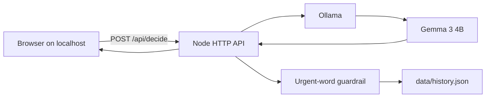

# Leave It

Leave It sorts a guilt pile on your own machine. Paste the messages and chores you have been avoiding. Gemma 3, running through Ollama, marks each line `leave`, `two_minute`, or `later`, and drafts the two-minute move when silence would cost you.

The careful version of those lines is the time you do not spend. Lines marked `later` do not count as saved, because you still owe them.

## Who it is for

One person with a list they keep rereading: unreplied chats, a renewal, a folder they meant to tidy. There is no account. The pile stays in a local JSON file.

## Architecture



The model is the sorter. The Node process checks the JSON, blocks a second request while a sort is running, and promotes a `leave` or `later` verdict when the line contains a hard urgency word such as `overdue`, `invoice`, `expired`, `landlord`, or `leak`.

## Stack

| Piece | Why |
| --- | --- |
| Node 22+ | Already installed. No Python, no native addons, no npm dependencies. |
| Ollama | Local OpenAI-style API. One process, no key. |
| `gemma3:4b` | Google's open-weight Gemma 3. About 3.3 GB. The 1B tag echoes the line instead of giving a reason. |
| JSON file | Enough history for a single user. No database server. |
| Vanilla page | No build step. The pile is a lined list. Output is written with `textContent`, so model text is not HTML. |

Ollama's `format` field is a JSON schema with `minItems` set to the line count. Constrained decoding is what makes the local model return an object the app can score. A "JSON only" sentence in the prompt is not reliable.

## Cost

Local inference. Disk for the model (about 3.3 GB) and this repo. No hosted API bill. The server binds to `127.0.0.1`.

## Setup

1. Install [Ollama](https://ollama.com/download) 0.6 or newer.
2. Pull the model:

```bash
ollama pull gemma3:4b
```

3. From this directory:

```bash
npm test
npm start
```

4. Open `http://127.0.0.1:8787`.

`OLLAMA_MODEL` selects another local tag, for example `gemma3:1b`. `PORT` changes the listen port. `HOST` stays on loopback unless you set it. A 4B sort of four lines took about three minutes on this machine.

## API

`POST /api/decide` with `{ "text": "one line\nanother" }`.

At most 12 lines, 500 characters each, 20 KB per request. A second sort while the first is running returns 429.

`GET /api/health` reports whether Ollama is up and the model is pulled.

`GET /api/history` returns the last 50 runs from `data/history.json`. Delete that file to wipe them. It is gitignored.

## Security

- The pile is not sent to a hosted model.
- The process listens on loopback.
- Static files cannot escape `src/public`.
- Model text is shown as text, not HTML.
- The guardrail can only make a verdict stricter. It cannot mark an urgent line as safe.

## Tests

```bash
npm test
```

`npm run smoke` calls the local model with a four-line pile. It needs Ollama.

## Credits

- [Gemma 3](https://ai.google.dev/gemma) by Google, served with the [Ollama gemma3 library](https://ollama.com/library/gemma3). Apache 2.0 weights for Gemma.
- Ollama's structured `format` field. The failure mode it prevents is described by Jangwook Kim in [Ollama Structured Outputs in Practice](https://dev.to/jangwook_kim_e31e7291ad98/ollama-structured-outputs-in-practice-getting-type-safe-json-from-local-llms-with-pydantic-m38).
- Local-inference tradeoffs from David Ucolo, [Running LLMs Locally in 2026](https://dev.to/daviducolo/running-llms-locally-in-2026-the-complete-guide-to-benefits-trade-offs-and-getting-started-32k).

## Challenge

Built for the [Hacktoberfest Open-Source AI Challenge: Week 3](https://dev.to/challenges/hacktoberfest-week3-2026-10-19), theme Slow and Steady. Prize category: Best Use of Gemma.
